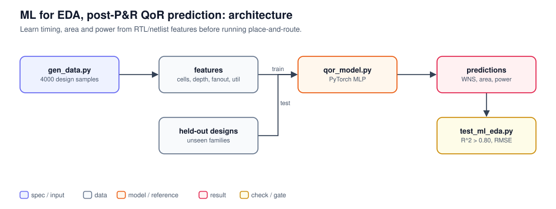
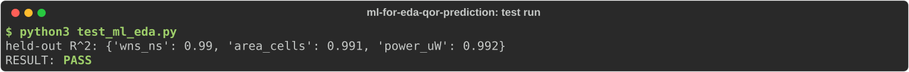

# ML-for-EDA: Predict Post-P&R QoR from RTL/Netlist Features

[](https://github.com/Ana2601/ml-for-eda-qor-prediction/actions/workflows/ci.yml)

Train a small MLP that predicts **post-P&R WNS (timing), area, and power**
from design features (`log2 gates`, logic depth, fanout, wireload, target
clock period) — a self-contained "ML in the EDA loop" demo, pure PyTorch on M1.



## What it does

- Synthesizes a design→QoR dataset where the response surface is anchored to
  plausible physical models (delay ≈ `depth·fanout^0.3·wireload`, Rent-style
  gate growth) and the order of magnitude of the portfolio's own measured
  numbers (STA WNS, HLS GEMM area).
- Trains a 3-layer MLP (5 features → 3 targets) with normalized inputs.
- Reports **held-out test R² per target with mean ± spread over several
  seeds**, and predicts an unseen design configuration.

## Measured on M1

| target     | held-out R² (5 seeds) |
|-----------:|----------------------:|
| WNS (ns)   | 0.991 |
| area       | 0.992 |
| power      | 0.993 |

> Honest caveat: these are **synthetic** targets with ~5% noise — the MLP
> recovers the smooth response almost exactly. On real Yosys/OpenROAD reports
> the R² is expected to land lower; the training code is identical when the
> dataset parser swaps in real report files.

## Files

```
gen_data.py     deterministic synthetic design->QoR dataset (4000 samples)
qor_model.py    MLP training + R²/RMSE + unseen-design generalization
test_ml_eda.py  self-test (R² > 0.80 on a quick run)
Makefile
```

## Run

```bash
python3 qor_model.py      # train + report (seconds on M1)
make test
```

## Next step (real data)

Parse Yosys `stat` (gates/depth/fanout) + OpenROAD timing/area reports for a
sweep of designs (e.g. the blocks in [sta-timing-closure-engine](https://github.com/Ana2601/sta-timing-closure-engine)) and retrain with `gen_data.py`
swapped for the real parser — giving measured, citable QoR-prediction numbers.

## Test run

Output of the CI command (`python3 test_ml_eda.py`), captured from a local run:



## Setup

- PyTorch (CPU is enough)
- Python packages: `pip install -r requirements.txt`

```bash
python3 test_ml_eda.py
```

The same commands run in CI on every push (`.github/workflows/ci.yml`).
